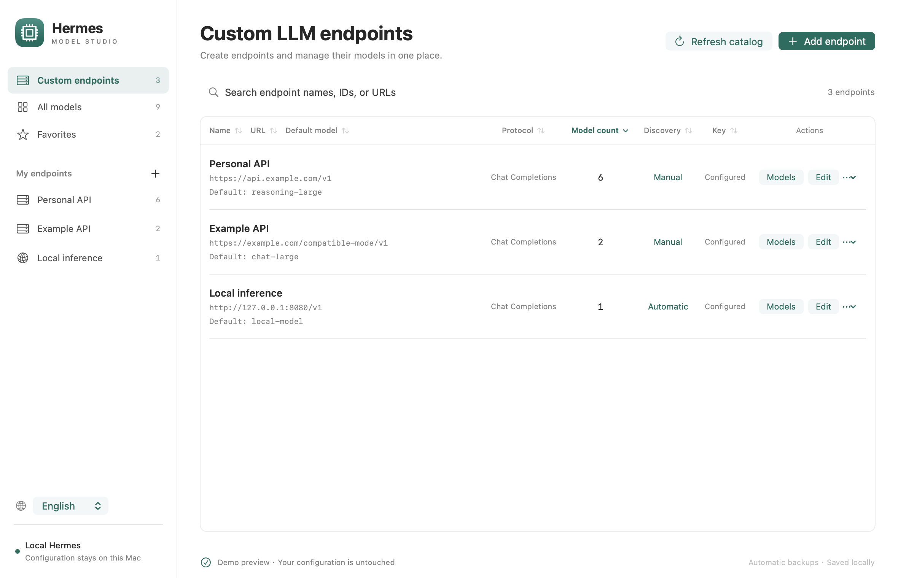
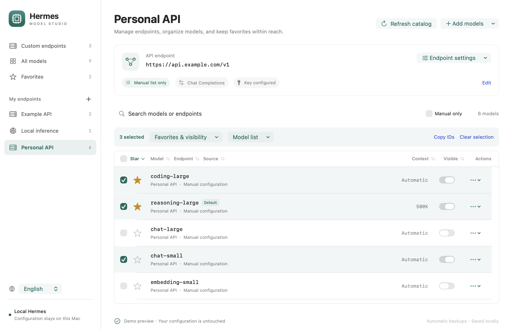

# Hermes Model Studio

English | [简体中文](README.zh-CN.md)

A native macOS companion for managing your local [Hermes](https://github.com/NousResearch/hermes-agent) LLM endpoints, models, and client favorites. The source repository is named **hermes-model-manager**; the desktop application is **Hermes Model Studio**.



## Features

- **Endpoint management:** create, search, edit, and remove custom endpoints; configure URLs, protocols, API key variables, default models, discovery, context limits, and timeouts.
- **Model management:** add individual models, paste batches of IDs, or fetch an endpoint's `/models` list. Edit model settings, remove manual entries, or keep only a selected list.
- **Shared favorites:** click a star to update Hermes's own favorites. Manage model visibility and client reasoning presets in the same interface.
- **Sortable tables:** sort endpoints, models, and discovery results from their headers. Counts and context lengths sort numerically; selections stay attached to model identities.
- **History cleanup:** unstar, hide, or forget models no longer listed in the catalog. Models still in configuration remain editable, with reference checks before removal.
- **English and Chinese:** English is the default. Switch to Simplified Chinese in the sidebar or Language menu without discarding edits.
- **Local backups:** configuration changes use validation, revision checks, backups, atomic replacement, and readback.



## Requirements

- macOS 13 or later.
- An existing local Hermes configuration for normal use. Tests and demo previews use synthetic data.

## Download the macOS app

Download from [GitHub Releases](https://github.com/jancee/hermes-model-manager/releases/latest):

| Mac | Package |
| --- | --- |
| Apple Silicon (M-series) | [macOS arm64 ZIP](https://github.com/jancee/hermes-model-manager/releases/download/v1.3.1/Hermes-Model-Studio-1.3.1-macOS-arm64.zip) |
| Intel | [macOS x86_64 ZIP](https://github.com/jancee/hermes-model-manager/releases/download/v1.3.1/Hermes-Model-Studio-1.3.1-macOS-x86_64.zip) |

Extract the ZIP and move **Hermes Model Studio.app** to Applications. Release packages include Python and the required parsers; no separate Python installation or developer tools are needed. Only macOS binaries are published. Checksums are provided with each release.

Choose **arm64** on an M-series Mac. Its application and bundled runtime are native Apple Silicon binaries and do not use Rosetta. The Intel package is intended for Intel Macs.

The app is ad-hoc signed and is not Apple-notarized. If macOS blocks the first launch because the developer cannot be verified, follow [Apple's per-app Open Anyway instructions](https://support.apple.com/en-us/102445) after confirming the download came from this repository.

## Build from source

Source builds require Xcode Command Line Tools and Python 3.10+. The following setup uses Python 3.12 and [uv](https://docs.astral.sh/uv/). Developer builds use a local interpreter; the [release packaging workflow](docs/releasing.md) embeds one.

```bash
git clone https://github.com/jancee/hermes-model-manager.git
cd hermes-model-manager
uv venv --python 3.12 .venv
uv pip install --python .venv/bin/python -r requirements-dev.txt
bash scripts/build.sh
.venv/bin/python scripts/install.py
open "$HOME/Applications/Hermes Model Studio.app"
```

The installer preserves an existing application in the project's ignored `backups/` directory. Quit and reopen the application to load an update; the installer does not quit running applications or restart Hermes.

Build scripts use `.venv/bin/python` by default and target the current Mac's architecture. Set `STUDIO_PYTHON` to another compatible interpreter or `STUDIO_ARCH` to `arm64` or `x86_64` when needed. Local builds are ad-hoc signed.

## Everyday use

1. Open **Custom endpoints** and add an endpoint, or edit an existing one. Save its settings before using **Set API key**.
2. Open the endpoint's models. Add IDs manually, paste a batch, or choose **Fetch endpoint models**.
3. Click a model's star to favorite or unfavorite it. The visibility switch controls whether it appears in Hermes's model menu.
4. Select rows for batch operations. **Keep only selected models** replaces the endpoint's manual list, disables discovery, and asks you to choose its default model.
5. Use the sidebar language selector or **Language → 简体中文** to change the interface language. Your choice is remembered. Endpoint names, model IDs, URLs, and other entered values are not translated.

An **endpoint default** does not change Hermes's global main model. Removal is refused when a model or endpoint is still referenced by a default, fallback route, or task. Built-in and subscription endpoints support client preferences; authentication and OAuth remain in Hermes. Legacy `custom_providers` entries are preserved rather than migrated.

**Not in catalog** means the current catalog did not return an ID. It is not an inference test. Manually configured models can still be edited or removed; history-only rows can be forgotten. Automatic discovery may bring a removed manual entry back into view. Disable discovery to maintain a fixed manual list.

## Data and backups

| Location | Purpose |
| --- | --- |
| `~/.hermes/config.yaml` | Custom endpoints and model settings |
| `~/.hermes/.env` | API keys referenced by `key_env` |
| `~/.hermes/ui-preferences.json` | Hermes client favorites, visibility, and model presets |
| `~/.hermes/backups/model-studio/` | Backups created before writes |
| macOS application preferences | This app's language and table sorting |

Use `--home /path/to/profile` when launching the executable to work with another Hermes profile. Client preferences follow Hermes's machine-root convention for profiles.

The app can read the running Hermes catalog on loopback and fetch `/models` from the endpoint you select. It does not send inference requests or collect telemetry. Existing secrets are not displayed; new keys are sent to the local adapter through standard input.

Backups can contain credentials and are created with owner-only file permissions. Do not attach real configurations, `.env` files, backups, or private screenshots to issues. See [Security](SECURITY.md).

Saved files do not force existing Hermes sessions to reload. Refresh the Hermes model catalog or start a new session when necessary. The app does not restart Hermes. Avoid editing the same files simultaneously with other tools: an external writer that ignores locking can still race with an update.

To restore a backup, stop writers of the relevant file and copy the chosen backup to its matching source path. Restore only the intended file: a configuration backup belongs in `config.yaml`, a preferences backup in `ui-preferences.json`, and a credentials backup in `.env`.

## Development

```bash
.venv/bin/python -m unittest discover -s tests -v
.venv/bin/python scripts/check-localization.py
.venv/bin/python scripts/check-project.py
bash scripts/check-ui.sh
bash scripts/build.sh
'dist/Hermes Model Studio.app/Contents/MacOS/HermesModelStudio' --self-test
```

The Python and packaged integration tests use temporary configurations. Native checks exercise sorting, stable selections, language changes, and actual AppKit text entry in an unshown window. They do not replace manual acceptance in a running Hermes client.

For an optional read-only check against your own Hermes installation:

```bash
'dist/Hermes Model Studio.app/Contents/MacOS/HermesModelStudio' --check-bridge --live
```

See the [documentation index](docs/README.md), [architecture](docs/architecture.md), [development guide](docs/development.md), [localization guide](docs/localization.md), [contribution guide](CONTRIBUTING.md), and [changelog](CHANGELOG.md).

## License

[MIT](LICENSE), copyright 2026 Jancee. See [third-party notices](THIRD_PARTY_NOTICES.md) for dependencies and upstream compatibility references.

This is an independent companion project, not an official Hermes application.
