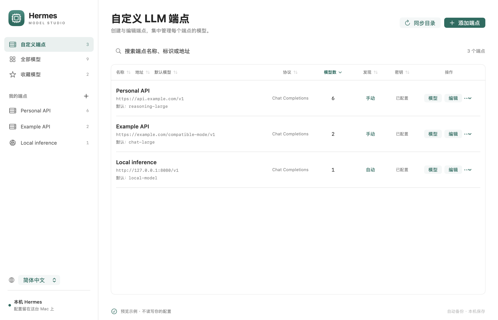
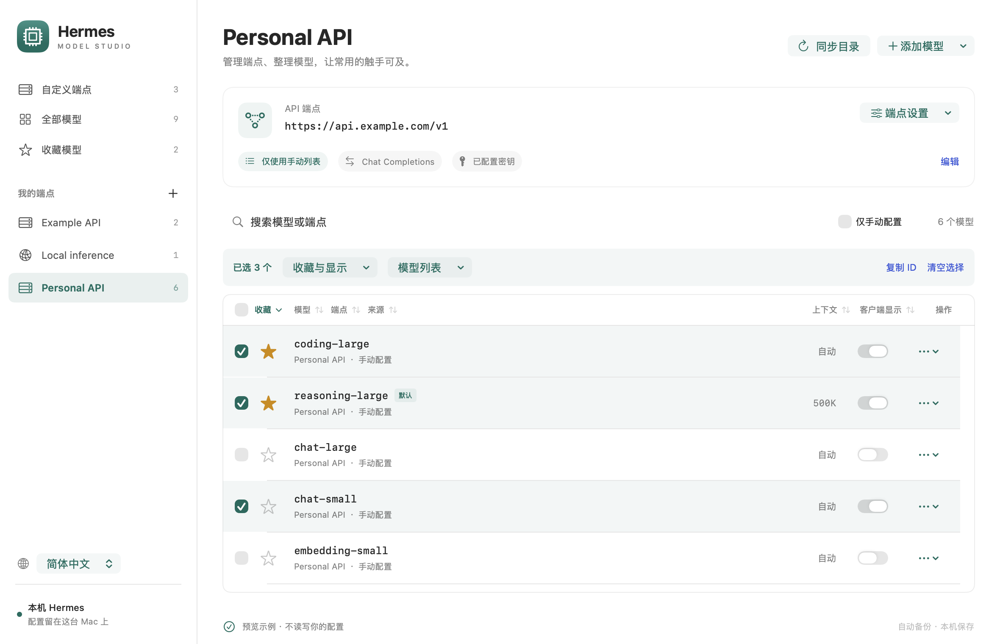

# Hermes Model Studio

[English](README.md) | 简体中文

用于管理本机 [Hermes](https://github.com/NousResearch/hermes-agent) LLM 端点、模型和客户端收藏的原生 macOS 配套工具。源码仓库名为 **hermes-model-manager**，桌面应用名为 **Hermes Model Studio**。



## 功能

- **端点管理**：新增、搜索、编辑和移除自定义端点；配置 URL、协议、API Key 变量、默认模型、自动发现、上下文上限和超时。
- **模型管理**：添加单个模型、批量粘贴 ID，或获取端点的 `/models` 列表。编辑模型参数、移除手动条目，或只保留选定的模型列表。
- **共享收藏**：点击星星直接更新 Hermes 自身的收藏，并在同一界面管理模型可见性和客户端推理预设。
- **表头排序**：点击表头对端点、模型和发现结果排序。数量及上下文长度按数值排序；选择状态始终绑定模型身份。
- **历史记录清理**：对目录中不再列出的模型取消收藏、隐藏或移除历史记录。仍在配置中的模型继续支持编辑，移除前会检查引用关系。
- **中英文界面**：默认英文，可从侧栏或 Language 菜单切换为简体中文，保留正在编辑的内容。
- **本地备份**：配置修改会执行校验、版本检查、备份、原子替换和读回验证。



## 环境要求

- macOS 13 或更高版本。
- 构建应用需要包含 Swift 的 Xcode Command Line Tools。
- Python 3.10 或更高版本。下方安装流程使用 Python 3.12 和 [uv](https://docs.astral.sh/uv/)。
- 正常使用需要已有的本机 Hermes 配置。测试和演示预览使用虚构数据。

构建默认使用当前 Mac 的架构。开发验证已在 Apple Silicon 上完成；分发 Intel 构建前，请在 Intel Mac 上验证。应用内附带 Python 解析依赖，但仍使用本机 Python 解释器，未内嵌解释器。

## 构建与安装

```bash
git clone https://github.com/jancee/hermes-model-manager.git
cd hermes-model-manager
uv venv --python 3.12 .venv
uv pip install --python .venv/bin/python -r requirements-dev.txt
bash scripts/build.sh
.venv/bin/python scripts/install.py
open "$HOME/Applications/Hermes Model Studio.app"
```

安装程序会将已有应用保留在项目中已被 Git 忽略的 `backups/` 目录。安装更新后，退出并重新打开应用以加载新版；安装程序不会结束正在运行的应用，也不会重启 Hermes。

构建脚本默认使用 `.venv/bin/python`。需要时，可用 `STUDIO_PYTHON` 指定其他兼容解释器，或将 `STUDIO_ARCH` 设为 `arm64` 或 `x86_64`。本地构建采用临时签名（ad-hoc）；本仓库未提供经过公证的发布版安装程序。

## 日常使用

1. 打开 **自定义端点（Custom endpoints）**，添加或编辑端点。先保存端点设置，再使用 **设置 API Key（Set API key）**。
2. 打开该端点的模型列表。手动添加 ID、批量粘贴，或选择 **从端点获取模型（Fetch endpoint models）**。
3. 点击模型的星星以收藏或取消收藏。可见性开关控制该模型是否出现在 Hermes 的模型菜单中。
4. 勾选模型进行批量操作。**只保留所选模型（Keep only selected models）** 会替换端点的手动列表、关闭自动发现，并要求选择该端点的默认模型。
5. 使用侧栏语言选择器或 **Language → 简体中文** 切换界面语言。应用会记住选择；端点名称、模型 ID、URL 等输入值保持原样，不参与翻译。

**端点默认模型** 不会改变 Hermes 的全局主模型。模型或端点仍被默认设置、备用路由或任务引用时，移除操作会被拒绝。内置和订阅端点支持客户端偏好管理；认证与 OAuth 仍由 Hermes 处理。旧版 `custom_providers` 条目会被保留，不会自动迁移。

**目录未返回（Not in catalog）** 表示当前目录没有返回该 ID，不代表进行过推理测试。手动配置的模型仍可编辑或移除；仅剩历史记录的条目可以清理。自动发现可能让已移除的手动条目再次出现在列表中；需要固定列表时，请关闭自动发现。

## 数据与备份

| 位置 | 用途 |
| --- | --- |
| `~/.hermes/config.yaml` | 自定义端点与模型参数 |
| `~/.hermes/.env` | `key_env` 引用的 API Key |
| `~/.hermes/ui-preferences.json` | Hermes 客户端收藏、可见性和模型预设 |
| `~/.hermes/backups/model-studio/` | 写入前创建的备份 |
| macOS 应用偏好 | 本应用的语言和表格排序设置 |

启动可执行文件时，可用 `--home /path/to/profile` 指定其他 Hermes Profile。客户端偏好遵循 Hermes 的 Profile 机器根目录约定。

应用可以通过本机回环地址读取运行中的 Hermes 目录，并从所选端点获取 `/models`。它不发送推理请求，也不收集遥测数据。界面不显示已有密钥；新密钥通过标准输入传给本地适配程序。

备份可能包含凭证，创建时采用仅文件所有者可访问的权限。不要将真实配置、`.env` 文件、备份或包含私人信息的截图附在 Issue 中。详见[安全说明](SECURITY.zh-CN.md)。

保存文件不会强制现有 Hermes 会话重新加载。需要时，刷新 Hermes 模型目录或新建会话；本应用不会重启 Hermes。请避免同时使用其他工具编辑同一文件：不遵守锁机制的外部写入程序仍可能与更新发生竞争。

恢复备份前，先停止对目标文件的写入，再将选定备份复制回对应的源路径。只恢复需要的文件：配置备份恢复到 `config.yaml`，偏好备份恢复到 `ui-preferences.json`，凭证备份恢复到 `.env`。

## 开发

```bash
.venv/bin/python -m unittest discover -s tests -v
.venv/bin/python scripts/check-localization.py
.venv/bin/python scripts/check-project.py
bash scripts/check-ui.sh
bash scripts/build.sh
'dist/Hermes Model Studio.app/Contents/MacOS/HermesModelStudio' --self-test
```

Python 测试和打包后的集成测试使用临时配置。原生检查在不显示的窗口中验证排序、选择身份、语言切换，以及实际的 AppKit 文本输入。这些检查不能代替在运行中的 Hermes 客户端进行人工验收。

如需对自己的 Hermes 安装执行可选的只读检查：

```bash
'dist/Hermes Model Studio.app/Contents/MacOS/HermesModelStudio' --check-bridge --live
```

更多内容见[文档索引](docs/README.zh-CN.md)、[架构说明](docs/architecture.zh-CN.md)、[开发指南](docs/development.zh-CN.md)、[本地化指南](docs/localization.zh-CN.md)、[贡献指南](CONTRIBUTING.zh-CN.md)和[变更记录](CHANGELOG.zh-CN.md)。

## 许可证

采用 [MIT 许可证](LICENSE)，版权所有 © 2026 Jancee。依赖和上游兼容性参考的许可信息见[第三方声明](THIRD_PARTY_NOTICES.md)。

这是独立的配套项目，并非 Hermes 官方应用。
